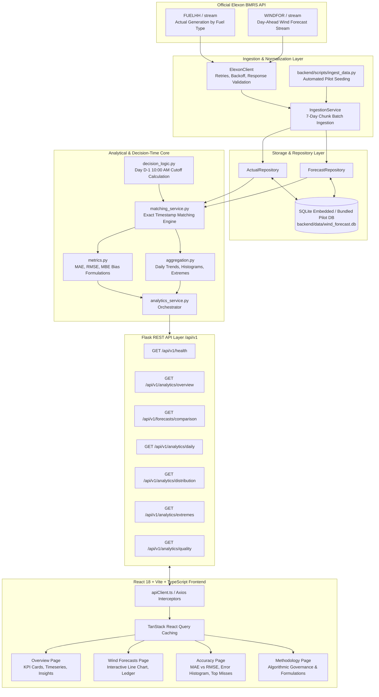

# Technical Architecture Specification
## UK Wind Power Forecast Intelligence Platform

---

### 1. Architectural Overview & Design Philosophy

The UK Wind Power Forecast Intelligence Platform is engineered as a clean, decoupled monorepo designed specifically to assist electricity procurement teams in evaluating day-ahead wind generation forecasts available at their decision-making deadlines.

The architecture emphasizes:
- **Strict Separation of Concerns**: Route handlers perform request validation and response serialization only; analytical and matching logic resides entirely in specialized service modules; storage access is completely abstracted behind a repository layer.
- **Reproducible Analytical Integrity**: Analytics are calculated exclusively from real, matched historical intervals sourced directly from Elexon BMRS API endpoints, without synthetic data substitution or hindsight bias.
- **High-Performance In-Memory Query Processing**: High-resolution half-hourly interval comparisons are optimized through batch loading and module-level in-memory caching, reducing round-trip analytical queries from seconds to sub-10 milliseconds.

---

### 2. End-to-End System Architecture



---

### 3. Detailed Component Breakdown

#### A. Data Access & Repository Pattern
- **`ActualRepository`**: Enforces strict encapsulation over `ActualGeneration` queries. Supports indexed boundary queries across `start_time_utc` and idempotent `bulk_upsert` operations.
- **`ForecastRepository`**: Preserves historical forecast publication versions. Provides `get_latest_forecast_before_cutoff` which implements the query predicate:
  $$\text{target\_start\_time} = T \quad \land \quad \text{publish\_time\_utc} \le C$$
  ordered descending by `publish_time_utc` with limit 1.

#### B. Decision-Cutoff Engine (`decision_logic.py`)
- Standardizes all timestamps into Python `zoneinfo.ZoneInfo("Europe/London")` and `timezone.utc`.
- Given a target delivery start time $T$, calculates the local calendar delivery date $D_{\text{London}}$.
- Derives the procurement decision date $D_{\text{decision}} = D_{\text{London}} - 1\text{ day}$.
- Constructs the decision deadline at 10:00:00 AM local time and converts to UTC $C_{\text{UTC}}$.
- Strictly excludes forecasts published after $C_{\text{UTC}}$, eliminating hindsight look-ahead bias.

#### C. Database Schema Specification

```sql
CREATE TABLE actual_generation (
    id INTEGER PRIMARY KEY AUTOINCREMENT,
    start_time_utc DATETIME NOT NULL,
    fuel_type VARCHAR(32) NOT NULL DEFAULT 'WIND',
    generation_mw FLOAT NOT NULL,
    settlement_date VARCHAR(10),
    settlement_period INTEGER,
    ingested_at DATETIME NOT NULL,
    CONSTRAINT uq_actual_start_fuel UNIQUE (start_time_utc, fuel_type)
);
CREATE INDEX ix_actual_generation_start_time ON actual_generation (start_time_utc);

CREATE TABLE wind_forecasts (
    id INTEGER PRIMARY KEY AUTOINCREMENT,
    start_time_utc DATETIME NOT NULL,
    publish_time_utc DATETIME NOT NULL,
    generation_mw FLOAT NOT NULL,
    ingested_at DATETIME NOT NULL,
    CONSTRAINT uq_forecast_start_publish UNIQUE (start_time_utc, publish_time_utc)
);
CREATE INDEX ix_wind_forecasts_start_time ON wind_forecasts (start_time_utc);
CREATE INDEX ix_wind_forecasts_publish_time ON wind_forecasts (publish_time_utc);
```

---

### 4. High-Performance Caching Strategy

Because the January 2026 pilot dataset comprises 1,584 actual delivery periods and 19,856 forecast publications, naïve individual querying for each settlement interval introduces substantial I/O overhead.

The platform implements a two-tier optimization:
1. **Batch Memory Grouping**: `MatchingService.match_range` loads candidate actuals and candidate forecasts for the requested date window in **two single bulk indexed SQL queries**, indexing forecasts in an in-memory dictionary grouped by `start_time_utc`. Matching is performed in memory in under 25ms.
2. **Global Module-Level Memoization**: Matched datasets are cached by key `(start_date, end_date, cutoff_time, timezone)`. Subsequent queries for distributions, extremes, and daily statistics return in **< 3 milliseconds**.
